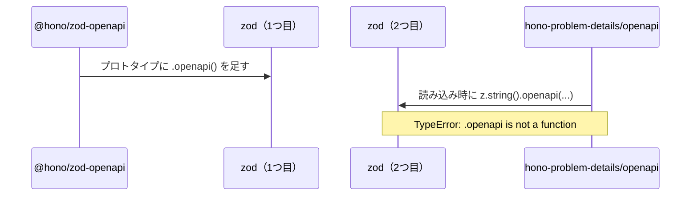

## はじめに

この記事は [Hono Advent Calendar 2026](https://qiita.com/advent-calendar/2026/hono) の 11 日目です。

2026 年 2 月に、Hono のエラーレスポンスを [RFC 9457](https://www.rfc-editor.org/rfc/rfc9457.html)（Problem Details for HTTP APIs）の形に揃えるミドルウェア **hono-problem-details** を公開しました。使い方は[公開時の記事](/blog/2026/hono-problem-details-rfc9457/)にまとめています。

https://github.com/paveg/hono-problem-details

それから 9 か月で v0.1.0 は v0.12.3 になりました。機能を足したリリースもありますが、振り返ると設計が大きく動いたのは、利用者から Issue や PR が届いたときでした。この記事では、最初から変えていない設計の軸と、利用者の Issue で変わったところを、判断の理由とあわせて書きます。

調査・事実確認に AI（Claude）を使い、AI が書いた下書きを僕が校正する形で執筆しています。

## 想定読者

- Hono で JSON API を書いていて、エラーレスポンスの形を揃えたい人
- Hono のミドルウェアやライブラリを npm に公開している、または公開しようとしている人
- OSS に Issue を出すと何が起きるのかに興味がある人

## TL;DR

- `app.onError(problemDetailsHandler())` の 1 行で、Hono の全エラーが `application/problem+json` になる。この入口は v0.1.0 から変えていない
- 利用者の報告で変わったのは、どれも「自分の手元の環境では起きない」問題だった
  - `moduleResolution: "node"` でサブパスの型が見つからない（[#67](https://github.com/paveg/hono-problem-details/issues/67)）
  - バンドルに zod が 2 つ入ると、モジュールを読み込んだ瞬間に落ちる（[#133](https://github.com/paveg/hono-problem-details/issues/133)）
  - Hono 5 で `onError` の呼ばれ方が変わり、型は通るのに全エラーが `text/plain` になる（[#226](https://github.com/paveg/hono-problem-details/issues/226)）
- 外部の方からの PR で、レスポンスに OpenTelemetry の `traceId` が入るようになった（[#139](https://github.com/paveg/hono-problem-details/pull/139)）
- 直すたびに、その報告を再現するテストを CI に足した。それでも、同じ種類の不具合をあとで自分で踏んだ

---

## hono-problem-details のおさらい

Hono の `HTTPException` をそのまま投げると、レスポンスは `text/plain` の `Not Found` になります。ルートごとに `{ error }` や `{ message }` を返していると、クライアントは形ごとに分岐を書くことになります。

RFC 9457 は、エラーの形を `type`・`status`・`title`・`detail`・`instance` の 5 つの標準メンバーと、任意の拡張メンバーで決める仕様です。hono-problem-details は `app.onError` に渡すハンドラーとして、この形を Hono アプリの既定にします。

```ts
import { Hono } from 'hono';
import { HTTPException } from 'hono/http-exception';
import { problemDetails, problemDetailsHandler } from 'hono-problem-details';

const app = new Hono();
app.onError(problemDetailsHandler());

app.get('/orders/:id', (c) => {
  const id = c.req.param('id');
  if (id === 'locked') {
    throw problemDetails({
      status: 409,
      type: 'https://api.example.com/problems/order-locked',
      detail: `Order ${id} is locked`,
    });
  }
  throw new HTTPException(404, { message: 'Order not found' });
});
```

```json
{
  "type": "https://api.example.com/problems/order-locked",
  "status": 409,
  "title": "Conflict",
  "detail": "Order locked is locked"
}
```

Zod・Valibot・Standard Schema のバリデーターの hook、`@hono/zod-openapi` 向けのスキーマ、エラーの種類を先に定義しておくレジストリも同梱しています。

---

## 変えなかった設計の軸

9 か月のあいだ、次の 4 つは変えていません。判断の理由は、リポジトリの [docs/adr](https://github.com/paveg/hono-problem-details/tree/main/docs/adr) に ADR（Architecture Decision Record）として残しています。

### 1. 入口は `app.onError` の 1 行

既存の `throw new HTTPException(404)` を書き換えずに導入できることを最優先にしています。ハンドラーは `ProblemDetailsError`、`mapError` の結果、`HTTPException`、それ以外の `Error` の順に見て、どれも Problem Details に変換します。

### 2. 標準メンバーは拡張メンバーに上書きされない

拡張メンバーはトップレベルに平らに展開しますが、名前がぶつかったら標準メンバーが勝ちます（[ADR-0002](https://github.com/paveg/hono-problem-details/blob/main/docs/adr/0002-extension-flatten-with-standard-field-precedence.md)）。`extensions: { status: 999 }` を渡しても、`status` は HTTP のステータスコードのままです。

### 3. エラーハンドラーの中では例外を外に出さない

`localize` や `mapError` は利用者が書くコールバックなので、例外を投げることがあります。これを `onError` の外に出すと、Hono が `onError` を呼び直したり、`app.request()` が reject したりして、クライアントには Problem Details ではないレスポンスが返ります。そこで、コールバックが投げた例外は握りつぶして、変換前の内容で応答します（[ADR-0003](https://github.com/paveg/hono-problem-details/blob/main/docs/adr/0003-swallow-exceptions-from-localize-callback.md)、[ADR-0005](https://github.com/paveg/hono-problem-details/blob/main/docs/adr/0005-swallow-exceptions-from-map-error-callback.md)）。翻訳が壊れても、404 は 404 のまま返ります。

### 4. 必須の依存は `hono` だけ

Zod や Valibot、OpenTelemetry との連携はすべて optional な peer dependency にしています。使わない連携のために依存が増えることはありません。

---

## 利用者の Issue で変わったところ

ここからが本題です。届いた報告と、それで変えたことを時系列で並べます。

| 時期    | きっかけ                        | 変えたこと                                       | リリース |
| :------ | :------------------------------ | :----------------------------------------------- | :------- |
| 2026-03 | #67 サブパスの型が解決できない  | `typesVersions` を追加                           | v0.1.6   |
| 2026-05 | #133 zod の二重読み込みで落ちる | スキーマの定数を廃止し、関数で返す（破壊的変更） | v0.7.0   |
| 2026-05 | #139 OpenTelemetry 連携の PR    | `otelApi` オプションで `traceId` を入れる        | v0.8.0   |
| 2026-11 | #226 Hono 5 で動かない          | `onError` の 2 つの呼ばれ方を両方受ける          | v0.12.1  |

### #67：`moduleResolution: "node"` でサブパスが import できない

最初に届いた外部からの Issue は、`hono-problem-details/standard-schema` を import すると型が見つからない、という報告でした。

```text
Cannot find module 'hono-problem-details/standard-schema' or its corresponding type declarations.
  There are types at '.../dist/integrations/standard-schema.d.ts', but this result could not be
  resolved under your current 'moduleResolution' setting.
```

`package.json` の `exports` にはサブパスを書いていましたが、TypeScript の `moduleResolution: "node"`（`node10`）は `exports` を読みません。僕の手元は `bundler` だったので、この差に気づいていませんでした。

直し方は `typesVersions` を足すだけです。

```json
{
  "typesVersions": {
    "*": {
      "zod": ["./dist/integrations/zod.d.ts"],
      "valibot": ["./dist/integrations/valibot.d.ts"],
      "openapi": ["./dist/integrations/openapi.d.ts"],
      "standard-schema": ["./dist/integrations/standard-schema.d.ts"]
    }
  }
}
```

修正は 8 行でしたが、返信までに 2 週間以上かかりました（Issue のコメントで謝っています）。

このあと、型の互換性を TypeScript 5.0 から 7.0 までの複数バージョンで確かめる CI を作り、`exports` と `typesVersions` の解決もそこで検証するようにしました（[#192](https://github.com/paveg/hono-problem-details/pull/192)）。新しいサブパスを足して `typesVersions` を書き忘れると、CI が落ちます。

### #133：zod が 2 つあると、読み込んだ瞬間に落ちる

5 月に届いた Issue は、Cloudflare Workers の大きなバンドル（300 以上のモジュール）を `wrangler deploy` すると、`hono-problem-details/openapi` を読み込んだ時点で次の例外が出る、というものでした。

```text
TypeError: e.string(...).openapi is not a function
```

原因は、`./openapi` がスキーマをモジュールのトップレベルで組み立てていたことです。

```ts
// v0.6.x の ./openapi（抜粋）
import { z } from '@hono/zod-openapi';

export const ProblemDetailsSchema = z
  .object({
    type: z.string().openapi({ description: 'Problem type URI' }),
    // ...
  })
  .openapi({ title: 'ProblemDetails' });
```

`.openapi()` は、`@hono/zod-openapi` が初期化時に zod のプロトタイプへ足すメソッドです。バンドルに zod が 2 つ入り、拡張されていないほうの zod でこのコードが評価されると、利用者のコードが 1 行も動く前に例外が出ます。利用者の側では、import しない以外に避ける手段がありません。



この Issue には、原因の分析と 2 つの修正案まで書かれていました。

- 案 A：定数をやめて、スキーマを返す関数にする（破壊的変更）
- 案 B：`Proxy` で包み、初めて触られたときに組み立てる（API はそのまま）

破壊的変更を避けたかったので、案 B を試しました。`.shape` や `.safeParse()` は動きましたが、`OpenAPIHono` に渡すと、生成された OpenAPI ドキュメントから `title: "ProblemDetails"` が消えました。`@asteasolutions/zod-to-openapi` はメタデータを、スキーマのオブジェクトそのものをキーにした `Map` で持っています。`Proxy` と中身のスキーマは別のオブジェクトなので、引き当てられません。

結局、報告者が推していた案 A にしました。v0.7.0 で `ProblemDetailsSchema` を廃止し、メモ化した関数 `getProblemDetailsSchema()` に置き換えています（[ADR-0004](https://github.com/paveg/hono-problem-details/blob/main/docs/adr/0004-defer-openapi-schema-construction-via-factory.md)）。

```ts
// v0.7.0 以降
import { getProblemDetailsSchema } from 'hono-problem-details/openapi';

const ProblemDetailsSchema = getProblemDetailsSchema();
```

再発を防ぐテストとして、モジュールを import しただけでは `.openapi()` が呼ばれないことを、spy で確かめています。

この修正が防ぐのは「評価のタイミング」の問題で、`hono-problem-details/openapi` の `z` が拡張されていない zod そのものに解決されるケースまでは防げません。Issue にもそう書いて閉じましたが、報告者の Worker で直ったかどうかは、まだ返事をもらっていません。

### #139：OpenTelemetry の `traceId` を入れたい

同じ 5 月に、外部の方から PR が届きました。エラーレスポンスに OpenTelemetry の `traceId` を入れて、フロントエンドからサーバーのトレースを引けるようにする、という提案です。ASP.NET Core の `ProblemDetailsFactory` が同じことをしている、という参照も付いていました。

設計で気にしたのは依存です。`@opentelemetry/api` をライブラリの中で import すると、使わない人にも依存が増えます。この PR は、利用者が `@opentelemetry/api` を引数で渡す形になっていて、必須の依存を増やしていませんでした。

```ts
import * as otelApi from '@opentelemetry/api';
import { problemDetailsHandler } from 'hono-problem-details';

app.onError(problemDetailsHandler({ otelApi }));
// トレースが有効なとき、レスポンスに "traceId" が入る
```

そのままマージし、v0.8.0 で出しました。直後に、型の互換性テストへ OpenTelemetry の連携を足す PR も同じ方から届いています（[#144](https://github.com/paveg/hono-problem-details/pull/144)）。

### #226：Hono 5 で、型は通るのに全エラーが `text/plain` になる

11 月には、Hono 5（`5.0.0-rc.1`）で使うと、どのエラーも `500 text/plain` になるという報告が届きました。

Hono 4 は `onError` のハンドラーを `(error, c)` で呼びます。Hono 5 では `onError` がエラーを扱うミドルウェアになり、`(c, next)` で呼んで、エラーは `c.error` に置きます。hono-problem-details は context をエラーとして、`next` を context として受け取り、`c.set is not a function` で落ちていました。

厄介なのは、型チェックが通ることです。ハンドラーの戻り値の型は Hono の `ErrorHandler` で、Hono 5 はこの型自体をミドルウェアの型に定義し直しています。`app.onError(problemDetailsHandler())` は、Hono 4 でも 5 でもコンパイルが通ります。

`hono` の peer dependency は `>=4.13.7` で上限を付けていないので、Hono 5.0.0 が出ればその範囲に入ります。Hono 4 の利用者を切り捨てたくもないので、1 つのビルドで両方の呼ばれ方を受けることにしました（[ADR-0006](https://github.com/paveg/hono-problem-details/blob/main/docs/adr/0006-support-both-hono-onerror-signatures.md)）。

```ts
// 処理の本体は handle(error, c) に置き、呼ばれ方だけを振り分ける
const dispatch = (first: Error | Context, second: Context | Next) => {
  if (typeof second !== 'function') return handle(first as Error, second);
  const c = first as Context;
  return c.error ? handle(c.error, c) : second();
};
return dispatch as unknown as ErrorHandler;
```

どちらの呼ばれ方かは、`first instanceof Context` ではなく、2 つ目の引数が関数かどうかで判定しています。理由は #133 です。バンドルに同じパッケージが 2 つ入ると、`instanceof` は別のクラスとして判定します。Hono 5 で 2 つ目の引数にくる `next` は関数で、Hono 4 の `c` は関数ではないので、この判定はクラスの同一性に頼りません。

`c.error` が無いのに `(c, next)` で呼ばれたときは、`next()` に流します。Problem Details を作る元のエラーが無いので、存在しない 500 を作らないためです。

Hono 5 の上でも全テストを回す CI ジョブを足して、v0.12.1 で出しました。報告者の再現コードと回避策が Issue に書かれていたので、確認は短時間で済みました。

---

## 同じ種類の不具合を、自分でもう一度踏んだ

Hono 5 の対応（#226）を出した 3 日後、今度は自分で不具合を見つけました（[#235](https://github.com/paveg/hono-problem-details/issues/235)）。CommonJS のビルドで、バリデーターの hook に `delegateToHandler: true` を付けると、422 のはずが 500 になります。

tsup は既定では ESM のビルドだけでチャンクを共有します。CommonJS では、`index.cjs` と `zod.cjs`、`valibot.cjs`、`standard-schema.cjs` がそれぞれ自分の `ProblemDetailsError` を持っていました。hook が投げたエラーは `zod.cjs` のクラスのインスタンスなので、ハンドラーの `error instanceof ProblemDetailsError` が偽になり、500 に落ちていました。

これは #133 と同じ「同じはずのものが 2 つある」問題を、今度はライブラリ自身のビルドで作っていたことになります。テストは `src` を直接 import していたので、ビルドしたあとの `dist` の形は一度も検査していませんでした。

`tsup.config.ts` に `splitting: true` を足し、`pnpm build` のあとに `dist` を CommonJS と ESM の両方から読み込んで、各 hook が 422 を返すことを確かめるテストを CI に入れました（v0.12.3）。

---

## 振り返って

4 つの報告と 1 つの自爆を並べると、共通点があります。どれも、僕の手元の環境（`moduleResolution: "bundler"`、zod は 1 つ、Hono 4、ESM、`src` を直接テスト）では起きない問題でした。

| 報告 | 手元で起きなかった理由                 | 足したテスト                                 |
| :--- | :------------------------------------- | :------------------------------------------- |
| #67  | `moduleResolution` が `bundler` だった | 複数の TypeScript で `exports` の解決を検証  |
| #133 | zod が 1 つしか入っていなかった        | import だけで `.openapi()` が呼ばれないこと  |
| #226 | Hono 4 しか入れていなかった            | Hono 5 の上で全テストを回すジョブ            |
| #235 | テストが `src` を直接読んでいた        | ビルド後の `dist` を CJS と ESM で読むテスト |

ライブラリを公開している人に持ち帰ってほしいことを、自分への戒めも込めて 3 つ挙げます。

- **モジュールのトップレベルで、他のパッケージの状態に頼る処理を動かさない。** 読み込み時の例外は、利用者に避ける手段がありません
- **`instanceof` で、パッケージをまたいだクラスの同一性を仮定しない。** バンドラーとビルドの設定しだいで、同じクラスは簡単に 2 つになります
- **型が通ることは、動くことの証明にならない。** Hono 5 の `ErrorHandler` のように、型のほうが追従して通ってしまうことがあります。テストは公開する形（`dist`）と、サポートするメジャーバージョンの上で回します

そして、報告者の方々には本当に助けられました。#133 は原因の分析と修正案まで、#226 は再現コードと回避策まで書いてくれていて、僕がやったのはほとんど「確かめて、選んで、テストを書く」ことでした。この場を借りてお礼を言います。ありがとうございました。

Hono 5 で使うなら v0.12.1 以降を入れてください。Issue も PR も歓迎です。

https://github.com/paveg/hono-problem-details

それでは、またね。
