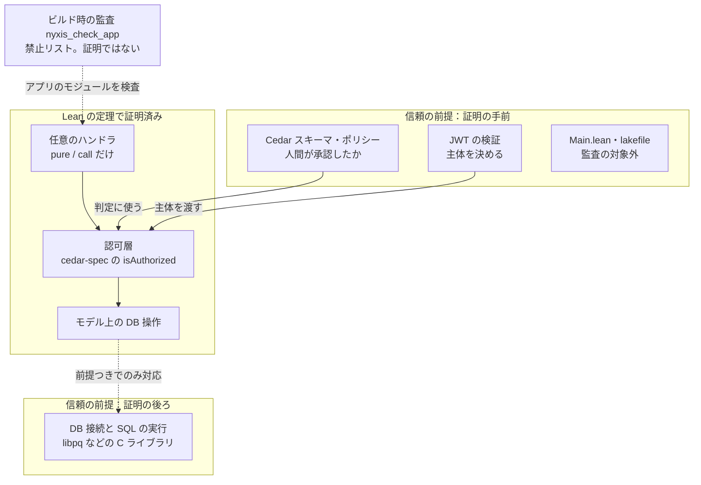
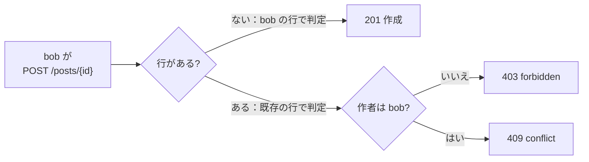

## はじめに

Lean[^lean] 製のバックエンドフレームワーク Nyxis が公開されました。X での公開時のポストは、次の一文で始まります。

> 情報漏洩が起きないことを数学的に保証するバックエンドフレームワーク「Nyxis」を公開しました！
>
> たぶん世界初です。

（[ポスト](https://x.com/banr1_/status/2114639107129540644)より。2026年10月26日）

数学は全くの門外漢ですが、Lean には前から興味がありました。

ここ最近はほぼすべてのコードを AI が書いていて、僕自身は、そのコードの品質を保ちながら出荷するための自動化の仕組みづくりと検証に、多くの時間を使っています。セキュリティの事故も続く今、安全性を形式検証[^fv]できる形で書ける仕組みは、喉から手が出るほど欲しいものです。

そこで手元でビルドして、ポストの主張を一つずつ反証できるか確かめてみました。**定理はきちんと検査を通りました。ただ、ポストは定理が保証する範囲より大きなことを言っていて、そのずれの一つは実際に動かして再現できます。**

なお、この記事は調査・再現・事実確認に AI（Claude）を使い、AI が書いた下書きを僕が校正する形で執筆しています。

## 想定読者

- Lean や形式検証に興味はあるが、証明そのものは読めない人
- 「数学的に保証」という言葉が何を約束しているのかを知りたい人
- AI エージェントにバックエンドを書かせることに不安がある人

## Nyxis は何を証明しているのか

Nyxis の発想はシンプルです。人間は Cedar[^cedar] のスキーマとポリシーだけを書いて承認し、ハンドラは AI エージェントに書かせてかまいません。そのハンドラが何をしても認可を破れないように、Nyxis はハンドラを型と定理で囲い込みます。

ハンドラの型は値を返す `pure` とアクションを呼ぶ `call` の2つしか持ちません。

```lean title="Nyxis/Handler.lean（docstring を除いて抜粋）"
inductive Handler (α : Type) : Type where
  | pure (a : α) : Handler α
  | call (action : EntityUID) (key : Db.Key) (values : Db.Row) (query : Db.ListQuery) (k : Outcome → Handler α) :
      Handler α
```

IO も DB 接続も書けないので、型の上では、ハンドラは認可層を通らないと DB に触れられません。リクエストヘッダの型には `Authorization` と `Cookie` がないので、ハンドラは JWT にも触れられません。

主定理 [`authorization_safety`](https://github.com/NyxFoundation/nyxis/blob/785c11a6285fe92901e871e1fc0f7064eda93941/Nyxis/Runtime.lean#L746-L771) は、どんなアプリ・初期状態・認証済みのリクエスト列についても、次のことを述べます。発行される DB 操作は、すべてそのリクエストの主体についてポリシーが許可したもので、スキーマで宣言した操作の範囲に収まります。主体や時刻、ID をハンドラが偽ることもできません。判定には Lean で形式化された Cedar の仕様（[cedar-spec](https://github.com/cedar-policy/cedar-spec)）の `isAuthorized` を使います。

ただし、保証の強さは部品によって違います。証明の手前と後ろに、信頼するしかない部分が残ります。



型の外の抜け道（実装の差し替えなど）は、`nyxis_check_app` が `unsafe` や `@[extern]` を禁止リストで拒否して塞ぎます。これは監査で、証明ではありません。

## 手元で確かめたこと

公開リポジトリには CI がないので、証明が通るかは自分でビルドして確かめるしかありません。

```shell
python3 scripts/prepare-dependencies.py   # JWT・PostgreSQL 系の依存を SHA256 で照合
lake build                                # 626 jobs, exit 0
```

cedar-spec などの Lean の依存は、`lake build` が git のリビジョンを固定して取得します。ビルド中に出力される公理の検査結果はこうでした。

```text
Nyxis.Runtime.authorization_safety depends on axioms: [propext, Classical.choice, Quot.sound]
1410 theorems under Nyxis depend only on [propext, Classical.choice, Quot.sound]
```

`sorry`（証明の穴埋め）や独自の公理は見当たりません。Nyxis の1,410個の定理すべてが Lean の標準の3つの公理だけに依存しています（[`Test/Axioms.lean`](https://github.com/NyxFoundation/nyxis/blob/785c11a6285fe92901e871e1fc0f7064eda93941/Test/Axioms.lean#L128)）。**証明そのものは本物です。** ここは素直にすごいと思いました。

## ポストと定理のずれ

次に、ポストの主張を定理やコードと突き合わせました。

| ポストの主張                                         | 判定       | 理由                                                   |
| :--------------------------------------------------- | :--------- | :----------------------------------------------------- |
| 情報漏洩が起きないことを数学的に保証                 | 言い過ぎ   | 定理は認可の安全性で、情報が漏れないことまでは含まない |
| 残りのコードを AI に任せても認可の安全性が担保される | 言い過ぎ   | ハンドラ以外の起動コードやビルド設定は監査の外         |
| 任意の HTTP リクエスト列に対して証明                 | 言い過ぎ   | 定理の対象は JWT 検証後のモデル上のリクエスト          |
| テストに頼る従来の開発に比べて、格段にセキュア       | 言い過ぎ   | 認可の安全性は、ソフトウェア全体の安全性ではない       |
| たぶん世界初                                         | 先行例あり | LWeb（POPL 2019）や STORM（OSDI 2021）がある           |

### 「情報漏洩が起きない」は再現で崩れる

定理が保証するのは「許可されていない操作は発行されない」ことです。拒否されたときの応答から何かが分かるかどうかは範囲外で、[`ASSUMPTIONS.ja.md`](https://github.com/NyxFoundation/nyxis/blob/785c11a6285fe92901e871e1fc0f7064eda93941/ASSUMPTIONS.ja.md?plain=1#L101) も、定理は非干渉[^ni]を述べないと明記しています。

実際に漏れる経路がありました。サンプルの掲示板には、alice の非公開下書き `draft1` を含む検査用サーバーがあります。主体を bob に固定する[1行だけを変えて](https://github.com/NyxFoundation/nyxis/blob/785c11a6285fe92901e871e1fc0f7064eda93941/examples/bulletin-board/backend/BulletinBoardTest/ServeFixture.lean#L30)、リクエストを送った結果がこちらです。

| bob のリクエスト   | alice の下書きあり | 下書きなし |
| :----------------- | :----------------- | :--------- |
| `GET /posts/{id}`  | 403                | 403        |
| `POST /posts/{id}` | 403                | 201        |

`GET` では区別できませんが、`POST` では下書きの有無で結果が分かれます。ID さえ推測できれば、`GET` が 403 を返す ID に `POST` を1回送るだけで、他人の非公開投稿があるかどうかが分かります。差が出るのは、作成時の判定がこう分岐するからです。



行がある場合、Nyxis は既存の行でポリシーを判定します（[`Authz.lean:160-165`](https://github.com/NyxFoundation/nyxis/blob/785c11a6285fe92901e871e1fc0f7064eda93941/Nyxis/Authz.lean#L160-L165)）。[作者本人だけに作成を許すポリシー](https://github.com/NyxFoundation/nyxis/blob/785c11a6285fe92901e871e1fc0f7064eda93941/examples/bulletin-board/backend/policies.cedar#L23-L28)なので、bob のリクエストは拒否されます。この判定は重複チェックより先に行われるので（[`stepOp`](https://github.com/NyxFoundation/nyxis/blob/785c11a6285fe92901e871e1fc0f7064eda93941/Nyxis/Authz.lean#L639-L655)）、他人の行に 409 は返りません。各分岐を手元で実測し、図のとおりの応答を確認しました。

なお 201 の側では bob の下書きが実際に作られるので、この探り方は痕跡を残します。また再現に使ったのはメモリ上の DB で、PostgreSQL ではありません。本番の経路も同じ判定関数を通るので同じ結果になると考えていますが、そこは確かめていません。

### 「残りを AI に任せても」の「残り」が広い

ハンドラは型で縛られていますが、サーバーを起動する [`Main.lean`](https://github.com/NyxFoundation/nyxis/blob/785c11a6285fe92901e871e1fc0f7064eda93941/examples/bulletin-board/backend/Main.lean#L37-L38) は違います。DB の接続文字列を読み、公開されている DB 接続関数を呼べる位置にあり、監査の後に読み込まれます。ビルド設定の [lakefile](https://github.com/NyxFoundation/nyxis/blob/785c11a6285fe92901e871e1fc0f7064eda93941/examples/bulletin-board/backend/lakefile.lean#L6) も、監査より前に任意のコマンドを実行できます。どちらも監査の対象外です。

ポリシーファイルに `permit(principal, action, resource);` を1行足すと、宣言済みのアクションが、スキーマで許した種類の主体全員に許されます。それでも定理は成り立ったままで、そのポリシーのもとではそれが「正当な権限」になります。止められるのは人間のレビューだけです。

`ASSUMPTIONS.ja.md` はこれらを信頼の前提として認めています。README も「[ハンドラを書く(AI エージェントに書かせる)](https://github.com/NyxFoundation/nyxis/blob/785c11a6285fe92901e871e1fc0f7064eda93941/README.ja.md?plain=1#L31)」と書いており、こちらは正確です。ポストの「残りのコード」だけが広すぎます。

### 証明で守れる範囲には限界がある

定理はモデル上の話です。実際の PostgreSQL 経路との一致は、「DB から取った行が現在の行と一致し、判定に必要な行をすべて含む」という前提つきでしか示されていません（[`PostgresRun.lean:1074`](https://github.com/NyxFoundation/nyxis/blob/785c11a6285fe92901e871e1fc0f7064eda93941/Nyxis/Internal/PostgresRun.lean#L1074)）。この前提には定理も実行時の検査もないと、[`docs/proofs.md`](https://github.com/NyxFoundation/nyxis/blob/785c11a6285fe92901e871e1fc0f7064eda93941/docs/proofs.md?plain=1#L71-L72) 自身が書いています。

書き込みについても、照合しているのは影響した行の件数（0か1）と操作の種類だけで、書き込んだ値は読み直していません（[`docs/proofs.md`](https://github.com/NyxFoundation/nyxis/blob/785c11a6285fe92901e871e1fc0f7064eda93941/docs/proofs.md?plain=1#L40)）。読み取りのほうは、行の中身まで照合しています。

これは Nyxis の欠点というより、形式検証そのものの性質です。証明が保証するのは、書いた性質がモデルの中で成り立つことだけです。その外側は上の図の「信頼の前提」として残ります。

外側で何が起きうるかは、10月下旬に公開された CVE を見ると分かります。

| 対象                                                                                                                                          | 内容                                       |
| :-------------------------------------------------------------------------------------------------------------------------------------------- | :----------------------------------------- |
| [PHP](https://thephp.foundation/blog/2026/10/21/todays-php-security-release-and-how-were-strengthening-php-security/)（CVE-2026-109618 ほか） | 処理系のメモリ破壊と use-after-free        |
| [GitLab](https://docs.gitlab.com/releases/patches/patch-release-gitlab-19-5-1-released/)（CVE-2026-110264）                                   | 正規表現のコンパイル時の整数オーバーフロー |
| [Envoy](https://github.com/envoyproxy/envoy/security/advisories/GHSA-3wvj-j6qm-62mr) ほか（CVE-2026-111497）                                  | Brotli の展開処理の境界外書き込み          |

どれも認可の不備ではなく、C で書かれた層のバグです。Nyxis のアプリでも、言語の実行環境や接続ライブラリ、前段のプロキシは証明の外にあります。こうした層のバグは、認可の定理がどれほど正しくても防げません。**「数学的に保証」はこうした層を信頼したうえでの保証です。** ポストの「格段にセキュアなソフトウェアを実現」は、この外側まで含めた言い方になっています。

### 「世界初」には先行例がある

Web アプリを、DB の行ごとの認可まで含めて形式化する研究は、以前からあります。

POPL 2019 の [LWeb](https://arxiv.org/abs/1901.07665) は Haskell の Web フレームワーク Yesod の上で、DB を含む情報フローの非干渉を Liquid Haskell で機械証明しています。2016年から公開されており、40テーブル規模のコンテストサイト（BIBIFI）に後から導入された実績もあります。LWeb が証明した非干渉は、情報の流れ全体を扱う点で、Nyxis の認可安全性とは別種の、より強い性質です。

OSDI 2021 の [STORM](https://www.usenix.org/conference/osdi21/presentation/lehmann) は、ORM の層に型でセキュリティの制約を付け、データに応じたポリシーをコンパイル時に強制します。形式検証した参照実装も用意されています。代わりに、アプリ側に少しの型注釈が必要です。

どちらも、証明の対象はモデルや参照実装で、実装との間に隙間がある点は Nyxis と同じです。注釈が要るのも同じで、Nyxis でも Cedar のスキーマに `@effect` などの独自の注釈を書き込みます。Nyxis の新しさは広く使われている Cedar のスキーマとポリシーの2ファイルだけを仕様にした点にあると思います。

## それでも良い試みだと思う理由

ここまで刺しましたが、僕はこのプロジェクトを高く評価しています。

まず、仮定の文書が誠実です。今回の指摘は種類としてはほぼすべて `ASSUMPTIONS.ja.md` か `docs/proofs.md` に書いてありました。書かれていなかったのは、`POST` の 403/201 という具体的な経路だけです。

設計も筋が良いです。ハンドラを証明するのではなく、ハンドラが何をしても破れない型を用意し、その型について一度だけ証明します。DB から一部の行だけを取っても、条件を満たせば判定が変わらないことまで証明しています（[`step_eq_of_covers`](https://github.com/NyxFoundation/nyxis/blob/785c11a6285fe92901e871e1fc0f7064eda93941/Nyxis/Authz.lean#L1794)）。モデルを実運用の性能につなぐための、地味ですが大事な補題です。

DB を操作する層の作り込みも面白いところです。Cedar を Web サーバーと組み合わせるなら、エンドポイントの入口で判定して終わることが多いと思います。Nyxis は SQL を発行する層まで自前で持ち、発行した SQL の結果をモデルの期待値と1件ずつ照合しています（[`docs/proofs.md`](https://github.com/NyxFoundation/nyxis/blob/785c11a6285fe92901e871e1fc0f7064eda93941/docs/proofs.md?plain=1#L43-L44)）。

AI がコードを書く量が増えるほど、人間がレビューする範囲を小さく保ちたくなります。その範囲を Cedar の2ファイルにまで縮めようという方向は、僕が欲しかったものに近いです。

## 誠実さの話

だからこそ、ポストの言葉が惜しいと感じました。定理からポストまでを並べると、言葉が2段階で大きくなっているのが分かります。

| 段階         | 言っていること                                                     |
| :----------- | :----------------------------------------------------------------- |
| 定理         | 権限外の操作は発行されない（モデルの中で）                         |
| ポストの冒頭 | 情報漏洩が起きないことを数学的に保証                               |
| ポストの中盤 | テストに頼る従来の開発に比べて、格段にセキュアなソフトウェアを実現 |

1段目から2段目で非干渉が、2段目から3段目でソフトウェア全体の安全性が加わっています。

公平のために書くと、ポストは定理の文そのものも正確に引用していて、後半では「証明外コードと実行環境は信頼する前提」だと書き、ポリシーを誤れば保護は得られないとも断っています。`ASSUMPTIONS.ja.md` も境界を正確に書いています。ずれているのは、読み手が最初に目にする冒頭と中盤の言葉の選び方です。

2段目を信じた人は、403 と 201 の差から情報が漏れることを想定しません。形式検証の価値は何を保証し何を保証しないかが厳密に決まることにあります。その境界をポストでぼかすと、形式検証を売りにする意味が薄れます。

強い言葉を選びたくなる事情は分かります。それでも、たとえば「認可の安全性を Lean で証明したバックエンドフレームワーク。保証の範囲は ASSUMPTIONS に明記」と書けば、十分に強く、しかも正確です。

その後、作者は同じ日のうちに[補足のポスト](https://x.com/banr1_/status/2114732685801427249)を出し、冒頭の表現が強すぎたと認めました。正確には「認可の安全性を数学的に保証するバックエンドフレームワーク」だと言い直しています。誤りを認めてすぐに言い直す対応は、誠実だと思います。

ただ、補足にある「認可不備による情報漏洩が起きないこと」にも、まだ少し幅があります。この記事で再現した `POST` の 403/201 は、ポリシーに違反した操作ではありません。それでも、許可と拒否の差そのものから行の有無が漏れます。定理が保証するのは権限外の操作が発行されないことまでで、認可の判定から漏れる情報は範囲外です。

## 最後に

Nyxis の定理は手元で検査を通り、設計も仮定の書き方も信頼できるものでした。一方で、ポストの「情報漏洩が起きない」「格段にセキュア」「残りを AI に任せても」「世界初」は、定理より大きな約束をしていました。このうち最初の1つは、作者自身が同じ日に訂正しています。

形式検証は、言葉の正確さがとりわけ問われる分野だと思います。v0.1 の段階でここまで来ているので、今後に期待しています。

それでは、またね。

## 参考リンク

### Nyxis

- [NyxFoundation/nyxis（記事中の行番号はコミット 785c11a 時点）](https://github.com/NyxFoundation/nyxis/tree/785c11a6285fe92901e871e1fc0f7064eda93941)
- [ASSUMPTIONS.ja.md（証明の外側で信頼する仮定）](https://github.com/NyxFoundation/nyxis/blob/785c11a6285fe92901e871e1fc0f7064eda93941/ASSUMPTIONS.ja.md)
- [docs/proofs.md（証明している定理の目録）](https://github.com/NyxFoundation/nyxis/blob/785c11a6285fe92901e871e1fc0f7064eda93941/docs/proofs.md)
- [公開時のポスト（X、2026年10月26日）](https://x.com/banr1_/status/2114639107129540644)
- [補足のポスト（X、2026年10月26日）](https://x.com/banr1_/status/2114732685801427249)

### 先行研究と関連技術

- [LWeb: Information Flow Security for Multi-tier Web Applications（POPL 2019, arXiv）](https://arxiv.org/abs/1901.07665)
- [STORM: Refinement Types for Secure Web Applications（OSDI 2021）](https://www.usenix.org/conference/osdi21/presentation/lehmann)
- [cedar-policy/cedar-spec（Cedar の Lean による形式化と証明）](https://github.com/cedar-policy/cedar-spec)
- [Introducing Cedar, an open-source language for access control（AWS, 2023-05-10）](https://aws.amazon.com/about-aws/whats-new/2023/05/cedar-open-source-language-access-control/)
- [Cedar 公式サイト](https://www.cedarpolicy.com/)
- [Lean 公式サイト](https://lean-lang.org/)

### CVE

- [Today's PHP Security Release（The PHP Foundation, 2026-10-21）](https://thephp.foundation/blog/2026/10/21/todays-php-security-release-and-how-were-strengthening-php-security/)
- [GitLab Critical Patch Release: 19.5.1（GitLab, 2026-10-21）](https://docs.gitlab.com/releases/patches/patch-release-gitlab-19-5-1-released/)
- [Out-of-Bounds Write in Brotli Decompressor（Envoy GHSA-3wvj-j6qm-62mr, 2026-10-23）](https://github.com/envoyproxy/envoy/security/advisories/GHSA-3wvj-j6qm-62mr)

[^lean]: Lean は定理証明支援系を兼ねたプログラミング言語です。書いた証明をカーネルが機械的に検査します。

[^fv]: 形式検証は、プログラムが仕様を満たすことを数学的に証明する手法です。テストが「試した入力で動く」ことを示すのに対し、証明は「すべての入力で成り立つ」ことを示します。

[^cedar]: Cedar は AWS がオープンソースで公開した認可ポリシー言語です（[AWS の発表](https://aws.amazon.com/about-aws/whats-new/2023/05/cedar-open-source-language-access-control/)）。言語の仕様は Lean で形式化され、性質が証明されています（[cedar-spec](https://github.com/cedar-policy/cedar-spec)）。

[^ni]: 非干渉（non-interference）は、権限のない人が観測できる結果が、見えないはずのデータによって変わらないという性質です。応答コードの違いのような間接的な漏れも禁じます。
